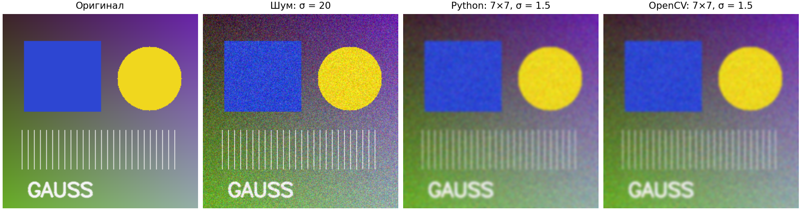
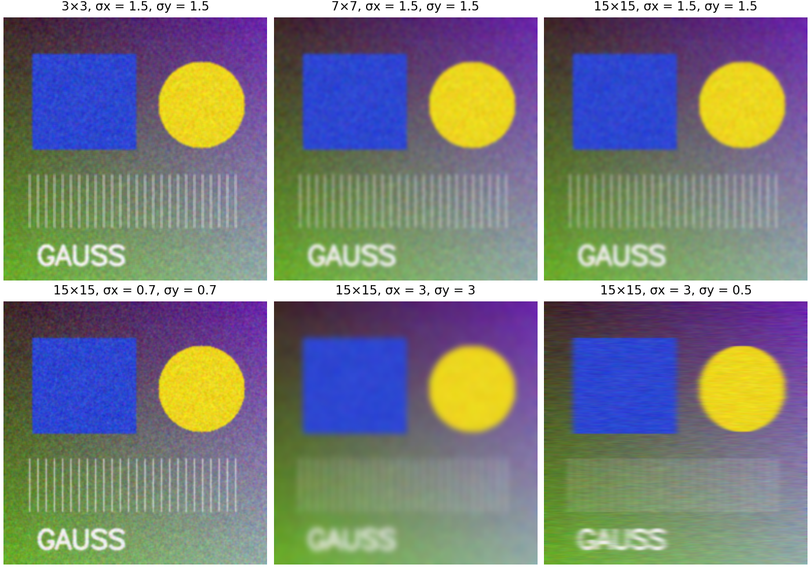
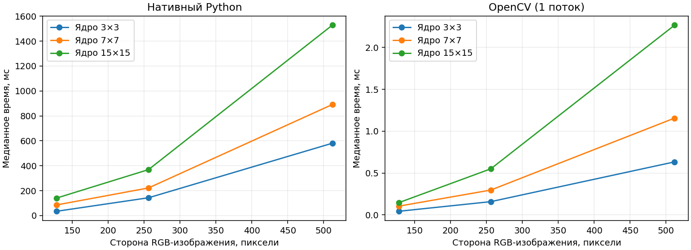

# Лабораторная работа №1. Усредняющий фильтр Гаусса

**Вариант 3:** фильтр Гаусса с переменным размером ядра и параметрами гауссианы.

Цель работы — реализовать алгоритм обработки изображений двумя способами, проверить корректность и сравнить быстродействие. В проекте представлены собственная реализация на Python и библиотечная реализация через `cv2.GaussianBlur`. Этот README является отчётом по работе.

## Запуск

Требуется Python **3.9–3.12**. Проверенная версия — Python 3.9.6. Графический интерфейс и видеокарта не нужны. Все команды выполняются из корня проекта.

```bash
python3 -m venv .venv
source .venv/bin/activate
python -m pip install -r requirements.txt

# Обработать включённое в проект тестовое изображение двумя способами
python main.py report/input.png --kernel 7 7 --sigma-x 1.5

# Запустить проверки
python -m unittest discover -s tests -v

# Повторить эксперименты и построить изображения, таблицы и графики
python generate_report.py
```

В Windows для активации окружения: `.venv\Scripts\activate` (cmd) или `.venv\Scripts\Activate.ps1` (PowerShell).

Пример с собственным изображением, прямоугольным ядром и разным сглаживанием по осям:

```bash
python main.py photo.jpg --kernel 15 7 --sigma-x 3 --sigma-y 1 --output output/photo
python main.py photo.jpg --kernel 5 5 --sigma-x 1.2 --grayscale --method native
python main.py --help
```

| Аргумент | Значение по умолчанию | Назначение |
| --- | --- | --- |
| `input` | Обязательный | Путь к изображению, например PNG или JPEG |
| `--kernel WIDTH HEIGHT` | `5 5` | Ширина и высота ядра; положительные нечётные числа |
| `--sigma-x` | `1.0` | Стандартное отклонение по горизонтали, строго больше 0 |
| `--sigma-y` | Равно `sigma-x` | Стандартное отклонение по вертикали, строго больше 0 |
| `--method` | `both` | `native`, `opencv` или обе реализации |
| `--grayscale` | Выключен | Преобразовать вход в оттенки серого |
| `--output` | `output` | Каталог результатов |

Результат: `native.png`, `opencv.png`, `difference.png` и `metrics.json` в указанной папке. При выборе одной реализации сохраняется только её изображение и метрики. Имена фиксированные: повторный запуск в той же папке заменяет соответствующие результаты; для независимых экспериментов указывайте разные папки. `difference.png` показывает абсолютную разность в шкале 0–255; малые дробные ошибки видны в JSON, а не на этом изображении. Время единичного запуска выводится для удобства; для сравнения скорости используйте `generate_report.py` с прогревом и повторениями.

## 1. Теоретическая база

Гауссово сглаживание заменяет значение пикселя взвешенным средним его окрестности. Близкие пиксели получают больший вес. Оно уменьшает высокочастотный шум, но одновременно размывает границы и мелкие детали.

Для гауссианы с центром в текущем пикселе:

$$
G(x,y)=\frac{1}{2\pi\sigma_x\sigma_y}
\exp\left(-\frac{x^2}{2\sigma_x^2}-\frac{y^2}{2\sigma_y^2}\right).
$$

В программе используется конечное дискретное ядро размером $k_x\times k_y$ с радиусами $r_x=(k_x-1)/2$, $r_y=(k_y-1)/2$. Его веса нормируются:

$$
K(i,j)=\frac{G(j,i)}{\sum_{u=-r_y}^{r_y}\sum_{v=-r_x}^{r_x}G(v,u)}.
$$

Здесь $i$ — смещение строки, $j$ — смещение столбца. Постоянный множитель гауссианы сокращается при нормировке. Сумма весов равна единице, поэтому постоянное изображение сохраняет яркость.

Для каждого канала $c$ вычисляется:

$$
I_{out}(y,x,c)=\sum_{i=-r_y}^{r_y}\sum_{j=-r_x}^{r_x}
K(i,j)I_{in}(y+i,x+j,c).
$$

Ядро симметрично, поэтому здесь результат совпадает и для свёртки, и для корреляции. Каналы обрабатываются независимо.

**Параметры.** Размер ядра определяет охват окрестности, а $\sigma_x$, $\sigma_y$ — распределение весов. При одинаковых σ сглаживание изотропно; при разных — сильнее вдоль одной из осей. При фиксированном ядре рост σ приближает веса к равномерным. При фиксированной σ увеличение ядра постепенно перестаёт заметно менять результат, поскольку дополнительные веса в хвостах малы. Практический ориентир — радиус около $3\sigma$; это рекомендация, а не ограничение программы. Среднее гауссианы равно нулю, чтобы фильтр не смещал изображение.

**Сепарабельность.** Гауссово ядро раскладывается в произведение двух одномерных:

$$
K(i,j)=g_y(i)g_x(j).
$$

Поэтому собственная реализация сначала сглаживает строки, затем столбцы. Для изображения $H\times W$ с $C$ каналами сложность уменьшается с $O(HWCk_xk_y)$ до $O(HWC(k_x+k_y))$. Это тот же математический фильтр. Дополнительная память — $O(HWC+Wk_x+Hk_y)$, включая промежуточные изображения и таблицы граничных индексов; Python-списки имеют заметные накладные расходы.

**Границы.** За пределами изображения повторяется ближайший граничный пиксель (`BORDER_REPLICATE`). Например, последовательность `[a, b, c]` дополняется как `[..., a, a, b, c, c, ...]`. Этот режим одинаков в обеих версиях и работает даже для изображения 1×1 и ядра больше изображения.

## 2. Описание разработанной системы

```text
ipcs-lab1/
├── gaussian_filter.py      # Ядро, собственная свёртка, вызов OpenCV
├── main.py                 # CLI, чтение и сохранение изображений
├── generate_report.py      # Тестовый образец, замеры и иллюстрации
├── tests/test_gaussian.py  # Автоматические проверки
├── requirements.txt        # Зафиксированные основные зависимости
├── report/                 # Готовые изображения, графики и данные эксперимента
└── README.md               # Отчёт и инструкции
```

Поток обработки: чтение изображения → проверка параметров → перевод в `float64` → фильтрация → сравнение результатов → округление и сохранение PNG.

### Собственная реализация

`gaussian_native` строит одномерные ядра через `math.exp`, нормирует их, вычисляет индексы с учётом границ и выполняет два прохода вложенных циклов Python. Взвешенные суммы и обращение к соседям реализованы вручную. Внутри свёртки нет `GaussianBlur`, `filter2D`, `convolve`, матричного умножения или векторизации NumPy. NumPy используется для проверки и преобразования входа/выхода, OpenCV — для ввода/вывода изображений.

### Библиотечная реализация

`gaussian_opencv` вызывает `cv2.GaussianBlur` с явно заданными размером ядра, `sigmaX`, `sigmaY` и режимом границ. Описание интерфейса приведено в [документации OpenCV](https://docs.opencv.org/4.11.0/d4/d86/group__imgproc__filter.html).

Обе функции получают `uint8` или `float64` и возвращают `float64` той же формы. Промежуточные результаты не округляются. Только перед сохранением выполняются округление к ближайшему целому (`np.rint`) и ограничение диапазоном 0–255. Так сравнение не искажается различиями целочисленных алгоритмов OpenCV. Из-за порядка арифметических операций возможны небольшие ошибки округления в плавающей точке.

CLI читает изображение как 8-битное BGR или как оттенки серого; порядок каналов не влияет на фильтрацию. Для графиков BGR переводится в RGB. Альфа-канал при чтении отбрасывается. Обработка RAW, HDR и сохранение 16-битной глубины в область работы не входят. Собственная версия предназначена для изучения алгоритма: для больших фотографий удобнее `--method opencv`.

Некорректные размеры ядра, нулевая/отрицательная/бесконечная σ, отсутствующие и повреждённые файлы приводят к сообщению об ошибке и ненулевому коду завершения.

## 3. Результаты работы и тестирование

### Изображения

Исходный образец создан программно в `make_sample`: цветовой градиент, прямоугольник, круг, тонкие линии и текст. К нему добавляется псевдослучайный нормальный шум с σ = 20, затем значения ограничиваются диапазоном 0–255. Генератор имеет фиксированное зерно `42`, поэтому пример воспроизводим и не требует внешних фотографий.



При ядре 7×7 и σ = 1.5 шум подавляется, однако тонкие линии и надпись становятся мягче. Результаты Python и OpenCV визуально совпадают. Файлы полного размера: [чистый образец](report/clean.png), [вход с шумом](report/input.png), [Python](report/native.png), [OpenCV](report/opencv.png).



Верхний ряд показывает изменение размера ядра при σ = 1.5. Разница между 7×7 и 15×15 невелика: большая часть веса уже попала в ядро 7×7. Нижний ряд показывает влияние σ при ядре 15×15. При σx = 3 и σy = 0.5 сглаживание выражено преимущественно по горизонтали.

### Численные результаты

Замеры выполнены 15 октября 2026 года: macOS 26.7.1, ARM64, Python 3.9.6, NumPy 1.26.4, OpenCV 4.11.0; один поток OpenCV. Полная информация о среде и временных выборках сохранена в `report/environment.json`.

| RGB-изображение | Ядро | Python, мс | OpenCV, мс | Ускорение | Макс. ошибка |
| --- | --- | ---: | ---: | ---: | ---: |
| 128×128 | 3×3 | 34.33 | 0.043 | 796.3× | 1.14e-13 |
| 128×128 | 7×7 | 85.22 | 0.104 | 815.6× | 1.14e-13 |
| 128×128 | 15×15 | 140.38 | 0.146 | 958.4× | 1.42e-13 |
| 256×256 | 3×3 | 142.76 | 0.158 | 903.5× | 1.42e-13 |
| 256×256 | 7×7 | 221.62 | 0.297 | 746.9× | 1.14e-13 |
| 256×256 | 15×15 | 368.78 | 0.550 | 670.2× | 1.71e-13 |
| 512×512 | 3×3 | 580.53 | 0.633 | 916.7× | 1.42e-13 |
| 512×512 | 7×7 | 891.22 | 1.156 | 770.6× | 1.42e-13 |
| 512×512 | 15×15 | 1528.40 | 2.267 | 674.2× | 1.71e-13 |

Для примера 256×256, ядро 7×7, σx = σy = 1.5:

| Метрика | Значение |
| --- | ---: |
| Максимальная абсолютная разность Python и OpenCV до округления | 1.137 × 10⁻¹³ |
| Средняя абсолютная разность | 1.723 × 10⁻¹⁴ |
| MSE зашумлённого изображения относительно чистого | 391.25 |
| MSE после фильтрации относительно чистого | 280.47 |

MSE — среднее квадрата ошибки по всем пикселям и каналам в шкале 0–255. На этом образце ошибка уменьшилась примерно на 28.3%. Метрика после фильтрации вычислена до округления в `uint8`; потеря чёткости на границах также входит в эту ошибку.

### Методика сравнения скорости

- Один и тот же трёхканальный вход `uint8` передаётся обеим функциям; расчёты выполняются в `float64`.
- Измеряется полный вызов фильтра: проверка входа, преобразование, построение ядра и индексов в собственной версии, выделение памяти, фильтрация и формирование выходного массива. Чтение файлов, генерация входа, сохранение и графики исключены.
- Перед замерами выполняется один прогревочный вызов каждой конфигурации. Затем берётся медиана трёх измерений через `perf_counter_ns`.
- Быстрые вызовы объединяются в пакеты: их размер оценивается по прогреву для длительности около 20 мс, с ограничением 2000 вызовов. Время пакета делится на число вызовов. Это уменьшает влияние таймера, но не устраняет влияние нагрузки системы.
- OpenCV использует один поток, OpenCL отключён. В каждой конфигурации σx = σy = 1.5, меняются размер изображения и ядра.
- Ускорение = время собственной реализации / время OpenCV. Результаты относятся к этим реализациям и среде, а не ко всем возможным реализациям алгоритма.



У графиков отдельные вертикальные шкалы. Увеличение площади изображения повышает время обеих реализаций; рост ядра увеличивает число операций. В собственной сепарабельной версии зависимость от размера квадратного ядра близка к линейной, но выделение памяти и преобразования добавляют постоянную составляющую. OpenCV выигрывает за счёт оптимизированного машинного кода и отсутствия интерпретации Python-циклов.

Сырые данные: [benchmark.csv](report/benchmark.csv), [параметры среды и все временные выборки](report/environment.json), [метрики качества](report/quality.json), [таблица в Markdown](report/table.md).

Для другого набора экспериментов:

```bash
python generate_report.py --sizes 128 256 512 --kernels 3 7 15 --repeats 5 --output output/experiment
```

Генератор обновляет данные и изображения в выбранной папке. Числовой блок README фиксирует исходный запуск и автоматически не переписывается; при повторном оформлении отчёта берите свежие значения из `table.md`, `environment.json` и `quality.json`.

### Проверки корректности

Команда `python -m unittest discover -s tests -v` проверяет:

1. Нормировку, симметрию и положительность ядра.
2. Совпадение с OpenCV для 48 сочетаний форм изображения, типов и параметров, включая один пиксель, строку, столбец, 1/3 канала и ядра больше изображения. Допуск абсолютной ошибки — `1e-10`.
3. Совпадение двух проходов с независимой прямой двумерной свёрткой на маленьком массиве.
4. Сохранение постоянного изображения.
5. Отклик на единичный импульс и независимость цветовых каналов.
6. Отклонение недопустимых параметров.
7. Отклонение недопустимых изображений.
8. Конечность и нормировку собственного ядра для очень малой и очень большой положительной σ.
9. Округление и ограничение значений при сохранении в `uint8`.

Все **9 тестов пройдены**. Сравнение с OpenCV дополнительно проверяет сохранение формы результата и неизменность входного массива. Число 48 — количество наборов внутри второго теста, а не число отдельных методов тестирования.

## 4. Выводы

Реализован гауссов усредняющий фильтр с регулируемыми размером ядра и стандартными отклонениями по обеим осям. Собственная реализация и OpenCV дают одинаковые результаты в пределах погрешности вычислений с плавающей точкой.

Сепарабельность уменьшает число вычислений относительно прямой двумерной свёртки. Несмотря на это, циклы Python существенно уступают OpenCV по скорости. Нативная реализация удобна для изучения устройства фильтра, а библиотечная — для практической обработки больших изображений.

Сглаживание снижает шум ценой потери мелких деталей. Размер ядра нужно выбирать совместно с σ: слишком маленькое ядро обрезает значимую часть распределения, а чрезмерно большое увеличивает затраты без заметного визуального выигрыша. На одном синтетическом образце нельзя сделать универсальный вывод об оптимальных параметрах для любых изображений.

## 5. Использованные источники

1. Методические указания «ЛР1» (`LW1.pdf`), предоставленные с заданием: требования к реализации, сравнению и структуре отчёта; вариант 3.
2. [OpenCV: Image Filtering — GaussianBlur, getGaussianKernel, sepFilter2D](https://docs.opencv.org/4.11.0/d4/d86/group__imgproc__filter.html) — интерфейс библиотечного фильтра и одномерные ядра.
3. [Python: time.perf_counter_ns](https://docs.python.org/3/library/time.html#time.perf_counter_ns) — счётчик времени для измерений.
